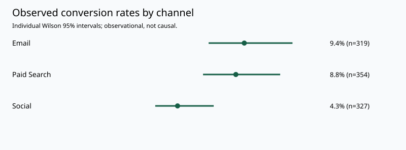
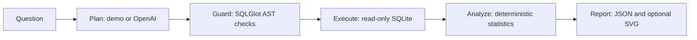

# LLM Analytics Agent

**A five-stage LangGraph workflow for marketing conversion analysis: question → SQL plan → guarded execution → statistical validation → report.**

The model proposes a query. Python checks the query, executes it against a read-only database, calculates statistical results, and produces a report with explicit assumptions. A deterministic demo mode runs without an API key.

> **v0.1 scoped prototype:** supports event-level conversion comparisons by marketing channel in the supplied SQLite schema. The demo and 33 automated tests pass locally. OpenAI planning is implemented and mock-tested; live paid calls have not been verified. BIRD/Spider benchmarks, general-purpose analytics and causal inference are not implemented.

## Try it without an API key

Python 3.11+ is required. From the repository root:

```sh
python -m venv .venv
```

Activate the environment with `.venv\Scripts\activate` on Windows Command Prompt, `.\.venv\Scripts\Activate.ps1` on PowerShell, or `source .venv/bin/activate` on macOS/Linux. If shell activation is unavailable, invoke the environment's Python executable directly.

```sh
python -m pip install -e ".[dev]"
python src/agent.py --mode demo --output output/demo.json --svg output/demo.svg
python -m pytest -q
```

The included `data/marketing.db` contains **1,000 synthetic events**, generated with seed 42 by `src/bootstrap_db.py`. That script recreates the sample table if run; it is not an importer for production data.

Demo mode recognizes a small set of fixed channel-comparison questions and refuses other questions. It does not simulate an LLM call.

## Example result



| Channel | Events | Conversions | Observed rate | Individual Wilson 95% CI |
|---|---:|---:|---:|---:|
| Email | 319 | 30 | 9.40% | 6.67%–13.11% |
| Paid Search | 354 | 31 | 8.76% | 6.24%–12.16% |
| Social | 327 | 14 | 4.28% | 2.57%–7.06% |

These are synthetic observational comparisons, not evidence of channel causality or real business lift. The full [demo JSON](docs/demo.json) includes a Pearson omnibus test and two-sided Fisher pairwise tests with Holm correction. Individual intervals are not simultaneous confidence intervals.

## How it works



| Stage | Implementation | Responsibility |
|---|---|---|
| Plan | `planner.py` | Schema-aware OpenAI Responses request with strict JSON schema; explicit unsupported-question path |
| Guard | `guardrails.py` | One SELECT, approved table/columns, unchanged event projections; reject writes, joins, subqueries and aggregation |
| Execute | `database.py` | SQLite read-only URI, query-only mode, authorizer, time and row limits |
| Analyze | `statistics.py` | Validate event data; Wilson intervals, expected-count checks, Fisher tests and Holm adjustment |
| Report | `workflow.py`, `chart.py` | Preserve SQL, sample sizes, assumptions and warnings; deterministic JSON/SVG |

The restricted row-level query contract is deliberate: aggregate or transformed model outputs are not accepted as if they were raw event evidence. Filters are supported but flagged for sample-selection concerns. This is a fixed workflow, not an unrestricted autonomous agent or MCP server.

## OpenAI mode (optional, paid)

Set `OPENAI_API_KEY` and `OPENAI_MODEL` in your shell or local environment manager. Select a model your API account can access that supports Responses with strict Structured Outputs. `.env.example` lists variables; files named `.env` are **not loaded automatically** by this project.

```sh
python src/agent.py "Compare conversion rates by channel" --mode openai
```

Only the question and fixed database schema are sent to OpenAI. Row data and statistical results are computed locally and are not included in the planning request. Requests use `store: false`, a timeout and an output-token cap; there is no automatic retry. A failed request can still incur provider charges. Do not include secrets or personal data in a question.

Provider availability, model access, billing and output validity can fail; invalid or unsupported plans stop before database execution. Prompt instructions treat questions as untrusted, while SQL restrictions are enforced separately in code.

## Optional local HTTP interface

```sh
python -m uvicorn analytics_agent.api:app --host 127.0.0.1 --port 8000
```

Open `http://127.0.0.1:8000/docs` for the interactive API. A demo request to `POST /analyze` is:

```json
{"question":"Compare conversion rates by channel","mode":"demo"}
```

Paid HTTP requests additionally require a configured `ANALYTICS_API_TOKEN` of at least 32 characters and an `Authorization: Bearer <local-token>` header. `ANALYTICS_DB_PATH` is configured on the server, not accepted from request input. The service is designed for personal loopback use; it has no multi-user authentication, billing quotas or production deployment hardening.

## Statistical validation

- Reject missing/nonbinary outcomes, duplicate or invalid event IDs, empty/invalid channel labels and empty results.
- Never silently analyze truncated output; queries exceeding the 10,000-event cap fail.
- Compute individual 95% Wilson binomial intervals.
- Use Pearson's channel-by-outcome chi-square test only when every expected count is at least 5.
- For sparse two-channel tables, use two-sided Fisher exact; withhold the omnibus approximation for sparse tables with more than two channels.
- Report pairwise Fisher tests with Holm correction across the reported pairwise family. The omnibus test is separate.
- Flag filtered samples and the inability to establish subject independence from event IDs. Repeated-user correlation and selection bias are not automatically resolved.

## Tests and evaluation

`python -m pytest -q` covers 33 cases: SQL attacks and unsupported shapes, SQLite defense in depth, data quality, interval/correction reference values, sparse/degenerate outcomes, graph execution, SVG escaping, mocked OpenAI contracts and HTTP authorization.

The suite uses synthetic data and mocked provider responses. It does not measure natural-language query accuracy, model robustness across prompts, or business impact. See [evaluation scope](evaluation/README.md). CI is configured for Python 3.11 and 3.12; live model tests are excluded.

## Structure

```text
src/
  agent.py                 CLI compatibility entry point
  bootstrap_db.py          Synthetic sample generator
  analytics_agent/
    planner.py             Demo/OpenAI planning
    guardrails.py          SQL AST validation
    database.py            Read-only execution
    statistics.py          Deterministic inference
    workflow.py            Five LangGraph nodes
    chart.py               SVG uncertainty plot
    cli.py / api.py        CLI and FastAPI entry points
 tests/                    Synthetic regression tests
 evaluation/               Evaluation scope and future benchmark notes
 docs/                     Reproducible demo artifacts
```

## Roadmap

- Add versioned natural-language/SQL/expected-result evaluation cases and run opt-in live-model evaluations.
- Extend metrics only alongside explicit data contracts and statistical tests.
- Add user-level identifiers and dependence-aware analyses for repeated observations.
- Add benchmark adapters before reporting BIRD/Spider results.

## License

MIT. See [LICENSE](LICENSE).
